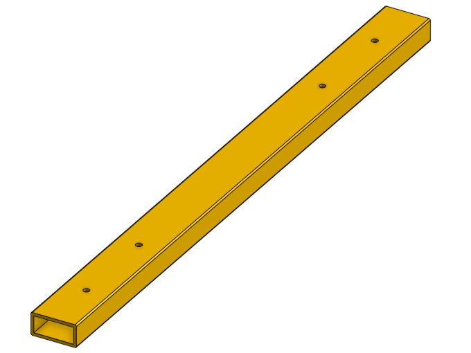

# 4. Make the front crossmember

**Start here:** [FRCDesign: First Tubes](https://frcdesign.org/learning-course/stage1/1a/section1-exercise1/) · [Sketch Basics](https://frcdesign.org/learning-course/stage1/1a/section1-exercise3/) · [Mirror and Pattern](https://frcdesign.org/learning-course/stage1/1a/section2-exercise3/).

**Stuck?** Linked lesson, Onshape help, or a veteran.

**Setup:** inches; [Tube Converter](https://frcdesign.org/learning-course/course-setup/required-course-tools/featurescripts/); [FRCDesignApp / FRCDesignLib](https://frcdesign.org/learning-course/course-setup/required-course-tools/part-library/).

## Shared dimensions

[Variable Studio steps](https://cad.onshape.com/help/Content/VariableStudio/variable_studio.htm) → `00 - Cart variables` → enable for all Part Studios and Assemblies.

| Variable            |    Value |
| ------------------- | -------: |
| `tubeWidth`         |     2 in |
| `tubeDepth`         |     1 in |
| `wall`              | 0.125 in |
| `crossmemberLength` |    27 in |
| `uprightHeight`     | 12.95 in |

## Make the crossmember

**Part Studio:** `01 - Front crossmember`.

1. Top plane → centered rectangle at origin → `#tubeWidth × #tubeDepth`.
2. **Extrude > New:** `#crossmemberLength`.
3. **Tube Converter:** wall `#wall`; Hole Pattern off.
4. Broad face → two circles on width centerline → **2.5 and 6.5 in** from one end. Dimension one **0.266 in**; Equal constraint on both.
5. Construction line across the width at `#crossmemberLength / 2` → Mirror circles.
6. **Extrude > Remove > Through all:** four holes, both walls.

**Name:** `FRAME-END-FRONT`. Features: `Tube profile`, `Tube length`, `Hollow tube`, `Hole pattern`, `Mounting holes`.

**Check:** fully constrained sketches; open ends; **1.75 × 0.75-in** inside opening.

**Try:** length **28 in** → hole centers **2.5, 6.5, 21.5, 25.5 in**. Then restore **27 in**.

