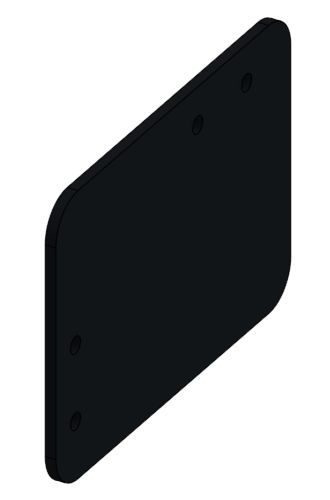

# Brackets, gussets, and mounting plates

**Start here:** [FRCDesign: Plate Workflow](https://frcdesign.org/learning-course/stage1/1a/section2-exercise1/) · [Repeated holes](https://frcdesign.org/learning-course/stage1/1a/section2-exercise3/).

* `PORTAL-GUSSET`: hole centers → dimension → outline → **Extrude thickness** → **Remove Through all** → corner fillets.
* Same tools: caster adapters, flat hinge cheeks, rail ears, stand brackets, backing plates.
* Check: matching bolt/pin holes; tool access.

