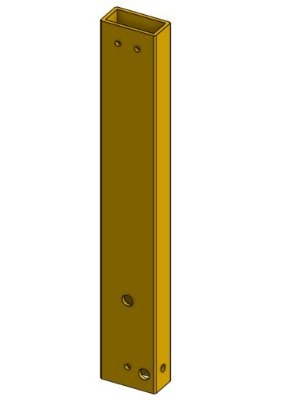

# Front upright

**Start here:** [FRCDesign: First Tubes](https://frcdesign.org/learning-course/stage1/1a/section1-exercise1/) · [Part Mirror example](https://frcdesign.org/learning-course/stage1/1c/exercise1/#part-studio-instructions).

**First:** [Set up shared variables](../4.-make-the-front-crossmember.md#shared-dimensions).

* `02 - Uprights` → Top plane → centered rectangle, `#tubeWidth × #tubeDepth`.
* **Extrude New:** `#uprightHeight` → **Tube Converter:** `#wall`, Hole Pattern off.
* Broad face → two **0.39-in** circles → **Remove Through all**, both walls.

| Hole         | Height from bottom | From right edge in picture |
| ------------ | -----------------: | -------------------------: |
| Pivot        |             0.6 in |                     0.4 in |
| Upright lock |             3.1 in |           1.0 in, centered |

* Remaining holes and end details: match reference part.
* Name: `POST-FRONT-R`; **Mirror > Part > New** across a broad face → `POST-FRONT-L`.
* Check: both lower pivots toward cart interior; one-sided holes on the correct faces.

