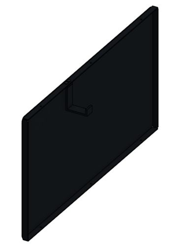

# Panels, trays, and bent brackets

**Start here:** [FRCDesign: Plate Workflow](https://frcdesign.org/learning-course/stage1/1a/section2-exercise1/) · [Onshape: Sheet Metal Model](https://cad.onshape.com/help/Content/PartStudio/sheet_metal_model.htm) · [Flange](https://cad.onshape.com/help/Content/PartStudio/sheet_metal_flange.htm).

* Branding panel: **26 × 14-in** rectangle → **Sheet Metal Model > Thicken: 0.080 in** → **Flange:** four **0.6-in** returns → holes → flat pattern.
* Floor panel: outline → dimensions → **Extrude thickness** → clearance cuts and mounting holes.
* Trays, reel cradle, U-brackets, keeper, coil hook: base sketch region → **Sheet Metal Model > Thicken** → thickness/bend radius → **Flange** → holes → flat pattern.
* Check: finished outside dimensions; equipment removal; bend radius and flat pattern with a veteran before cutting.

