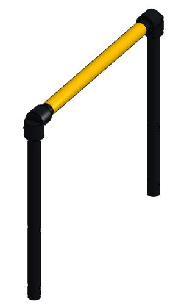

# Push handle

**Start here:** [Onshape: Extrude](https://cad.onshape.com/help/Content/PartStudio/extrude.htm) · [FRCDesign: Assembly](https://frcdesign.org/learning-course/stage1/1a/section3-exercise1/).

* Concentric circles → outside diameter and wall → **Extrude ring** to pipe length.
* Uprights → pin-hole sketch on a plane through the pipe axis → **Remove Through all**, both directions.
* Two `HANDLE-PIPE-UPRIGHT` parts + `HANDLE-CROSS-PIPE` + supplied elbows and grip.
* Check: bushing fit; pin alignment; hand clearance.

