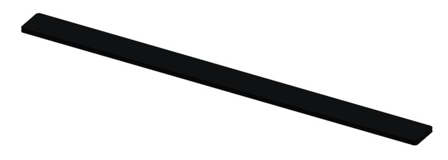

# Robot contact pad

**Start here:** [FRCDesign: Sketch Basics](https://frcdesign.org/learning-course/stage1/1a/section1-exercise3/) · [Onshape: Extrude](https://cad.onshape.com/help/Content/PartStudio/extrude.htm).

* `03 - Contact pad` → Top plane → centered **26.25 × 2-in rectangle**.
* **Extrude New:** **0.25 in**. Solid pad; no Tube Converter.
* Name: `ROBOT-PAD`.

