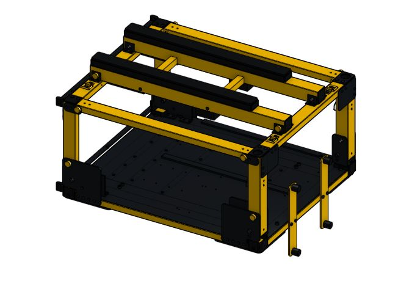

# 6. Assemble the cart

**Start here:** [FRCDesign: Fastened mates](https://frcdesign.org/learning-course/stage1/1a/section3-exercise1/) · [Onshape: Mate connectors](https://cad.onshape.com/help/Content/Assembly/assembly_mate_connector.htm).

**Assembly:** `Cart - working`. Insert parts → select matching hole centers/contact faces → align mate connectors → mate. One Fastened mate per fixed connection; check remaining holes.

**Portal:** two posts + top tube (crown), moving together.

| Order | This part → this part                                                | Mate/action                                        |
| ----: | -------------------------------------------------------------------- | -------------------------------------------------- |
|     1 | Insert `FRAME-END-FRONT` at origin                                   | Right-click part → **Fix**                         |
|     2 | `BASE-LONG` + outer base rails → front end; rear end → one long rail | **Fastened**; tube tops level                      |
|     3 | Floor crossmembers → long rails; floor pan → tube tops               | **Fastened**                                       |
|     4 | Front posts → front crown; rear posts → rear crown; gussets → joints | **Fastened**; two rigid portals                    |
|     5 | Hinge cheeks → base ends; rear-left U-bracket → rear base end        | **Fastened**                                       |
|     6 | Each portal's lower pivot hole → corresponding hinge-bracket hole    | **Fastened** upright; one locating mate per portal |
|     7 | Rail ears → posts; rail-angle shoes → crowns                         | **Fastened**                                       |
|     8 | Each upper side rail → front ear                                     | **Fastened**; rear pin holes aligned               |
|     9 | Ladder ties/end bars → robot rails                                   | **Fastened**; one lift-off ladder                  |
|    10 | Contact bars → robot rails; rubber pads → contact bars               | **Fastened**                                       |
|    11 | Complete ladder → one crown-mounted shoe                             | **Fastened**; all four pin locations aligned       |

**Names:** `Front portal pivot`, `Rear portal pivot`, `Ladder to crown`, `Pad to bar`.

**Next:** [Handle, panels, wheels, and equipment](handle-panels-wheels-and-equipment.md) → [Check the fold](check-the-fold.md).
