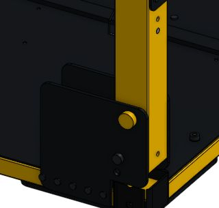

# Check the fold

**Start here:** [FRCDesign: Rotating joints](https://frcdesign.org/learning-course/stage2/2b/assembly/) · [Onshape: Revolute mate](https://cad.onshape.com/help/Content/Assembly/revolute_mate.htm) · [Suppress parts](https://cad.onshape.com/help/Content/Assembly/instances_list.htm).

* Duplicate assembly tab → `Cart - fold check`.
* Suppress side rails, robot ladder, handle, keeper, removable equipment, their retention pins, and upright lock pins.
* Edit the two portal pivot mates: **Fastened → Revolute**. One Revolute per rigid portal; lower pivot axes aligned.
* Rotate each portal inward → check clearance throughout travel. Panel follows front portal; bushings follow rear portal; shoes stay on crowns.
* Finished check → return to `Cart - working`.

