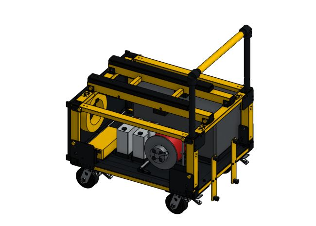

# Handle, panels, wheels, and equipment

**Start here:** [Onshape: Fastened mate](https://cad.onshape.com/help/Content/Assembly/fastened_mate.htm) · [FRCDesign: Repeated hardware](https://frcdesign.org/learning-course/stage1/1a/section3-exercise4/).

**All rows:** Fastened mates for installed positions; matching mounting faces and holes.

| Order | This part → this part                                                                                           |
| ----: | --------------------------------------------------------------------------------------------------------------- |
|    12 | Caster adapters → base corners; supplied caster mounting plates → adapters                                      |
|    13 | Stand brackets → rear base end; rubber feet → brackets                                                          |
|    14 | Panel brackets → front portal; panel → brackets; hook → panel; upper guards → front portal; lower guards → base |
|    15 | Handle uprights → elbows; cross-pipe → elbows; grip → cross-pipe                                                |
|    16 | Bushings/stops → rear posts; complete handle → one bushing; both pin holes aligned                              |
|    17 | Toolbox cradle/skids/stops → floor/base; toolbox → skids; keeper → outer base rail                              |
|    18 | Battery trays + reel cradle → floor/support tubes; pads/strap loops → mounts; equipment → trays/cradle          |
|    19 | Bolts, washers, nuts, pins → their mounting holes; repeat matching hardware                                     |

**Check:** drawer travel, equipment lift-out, handle removal, caster clearance.

