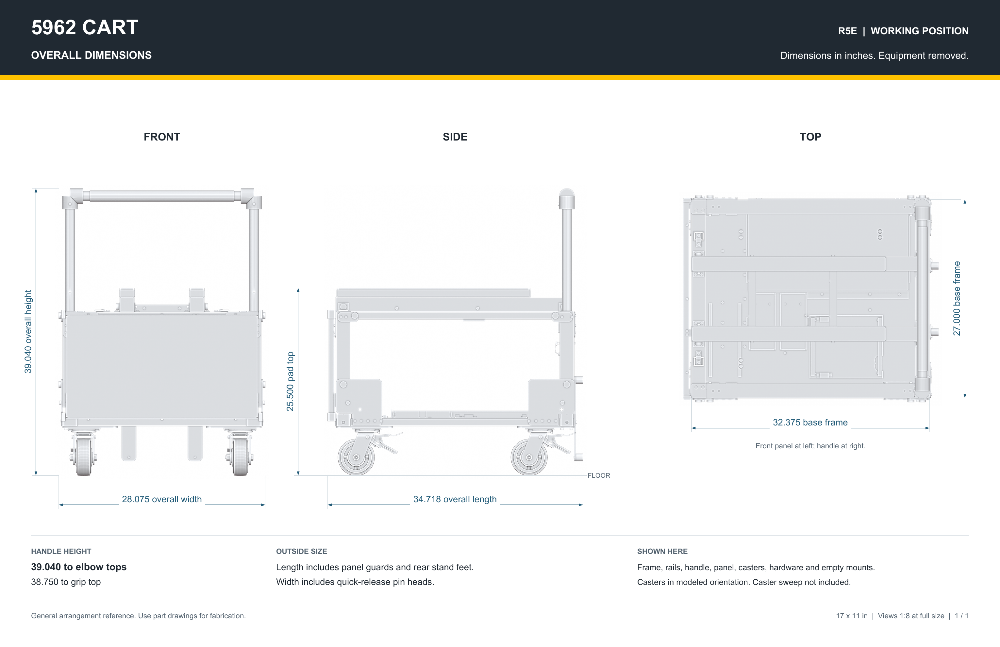
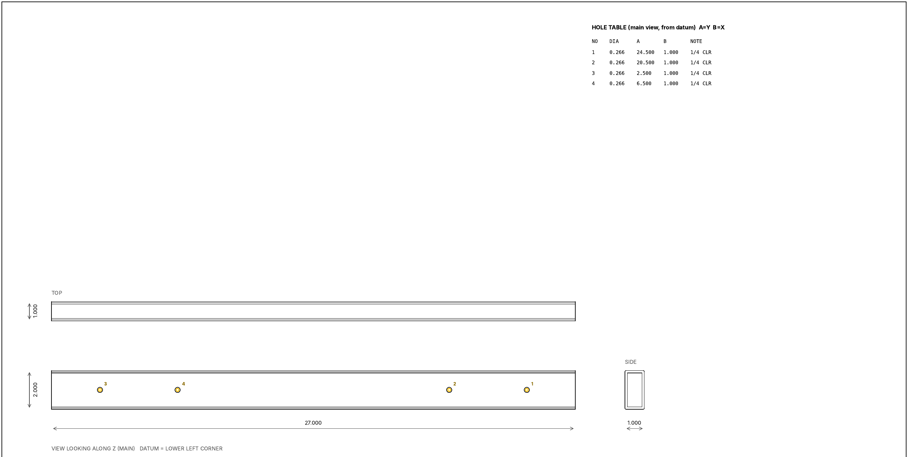
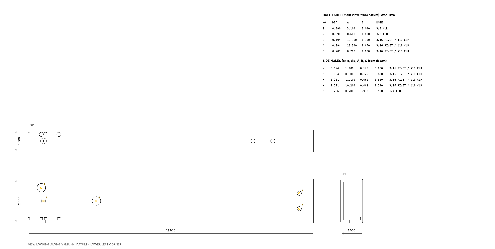
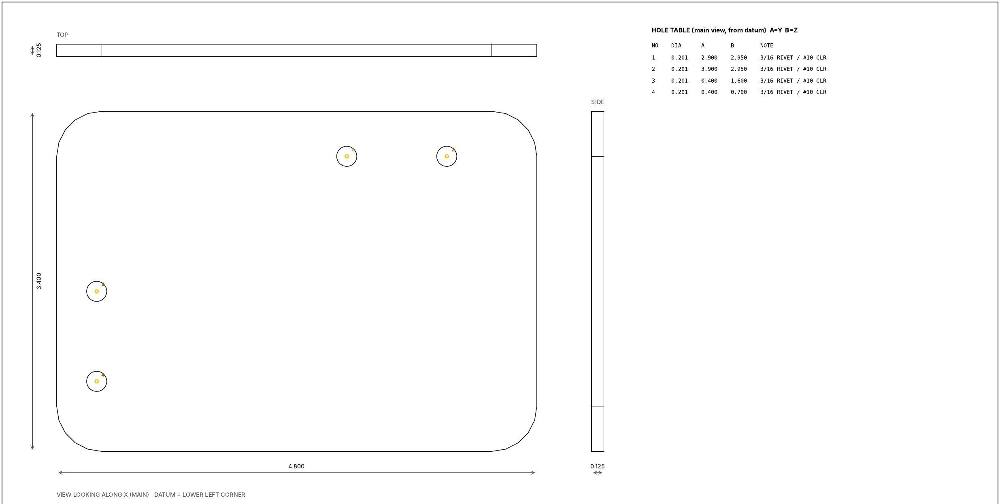

# 7. Make drawings

## Full-cart drawing

**Start here:** [Onshape: Create a drawing](https://cad.onshape.com/help/Content/Drawing/creating_a_drawing.htm) · [Display states](https://cad.onshape.com/help/Content/Assembly/display_states.htm).

* Hide removable equipment → save display state `Cart - no equipment`.
* Drawing → select that display state → front, side, top views.
* Dimension overall length/width/height, handle height, and robot-support height from the floor.
* Keep wheels, handle, panel, guards, and mounts visible.



**Check:** About **28 in wide** (**28.075 in** including pin heads). Check the actual storage opening and leave room to roll the cart in.

## Crossmember drawing

**Start here:** [Onshape: Drawing dimensions](https://cad.onshape.com/help/Content/Drawing/drawing_dimensions.htm).

* Right-click part → **Create drawing** → inch template → suggested views.
* Dimension length, tube size/wall, hole diameters, and hole centers.
* Title block: part name, material, quantity **1**, revision.

Examples below: inches; A = across the main view, B = up from its lower-left corner. Click to enlarge.

## Upright drawing

**Start here:** [Onshape: Drawing dimensions](https://cad.onshape.com/help/Content/Drawing/drawing_dimensions.htm).

* Broad-face, side, end views → height, tube size, pivot/lock holes, remaining holes.
* Mark hole depth or through-both-walls. Identify left/right parts; quantity **2 total**.

## Gusset drawing

**Start here:** [Onshape: Drawing dimensions](https://cad.onshape.com/help/Content/Drawing/drawing_dimensions.htm).

* Face + edge views → width, height, thickness, four holes; quantity **4**.
* Add the corner-radius callout missing from this example.

