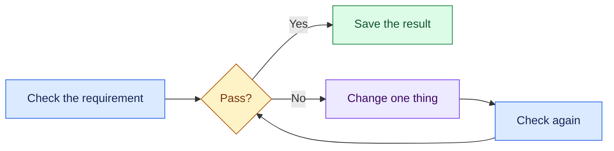

# 9. Test and improve

**Copy and fill:** Requirement \_\_\_\_\_\_\_ | Result \_\_\_\_\_\_\_ | Change \_\_\_\_\_\_\_ | Recheck \_\_\_\_\_\_\_.

**Example:** Length change | Far holes stayed in place | Mirror about `#crossmemberLength / 2` | At 28 in, far holes move to 21.5 and 25.5 in.

Save a version before a change and another after checking it. Ask a partner to explain your sketch, one mate, and one test result.

**Before building:** Mentor check: dimensions, joints, hardware, test plan. Include gear in the load calculation; measure trailer clearance. CAD alone does not prove the cart can carry the load.
