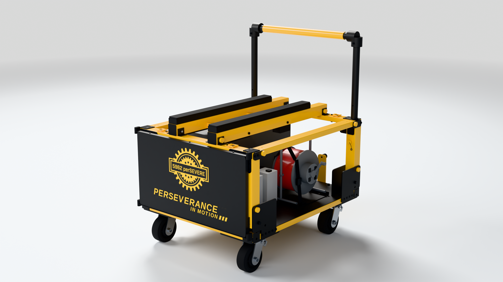
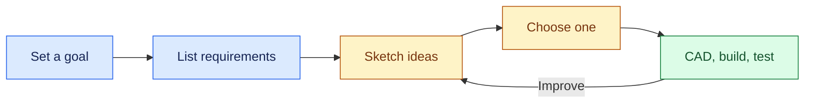

# Design a cart that works

Your challenge: move the robot, carry the gear, and fit everything into the trailer.

Goals, concept heights, costs, and scores below are practice examples. Use your team's measurements before choosing a design.

## Lessons

<table data-view="cards"><thead><tr><th></th><th data-hidden data-card-target data-type="content-ref"></th></tr></thead><tbody><tr><td><strong>🎯 1. Set a SMART goal</strong> Define what success looks like.</td><td><a href="1.-set-a-smart-goal.md">1.-set-a-smart-goal.md</a></td></tr><tr><td><strong>📏 2. List requirements</strong> Set targets you can check.</td><td><a href="2.-decide-what-it-must-do.md">2.-decide-what-it-must-do.md</a></td></tr><tr><td><strong>⚖️ 3. Compare ideas</strong> Score ideas. Pick a direction.</td><td><a href="3.-compare-ideas-and-choose.md">3.-compare-ideas-and-choose.md</a></td></tr><tr><td><strong>🧱 4. Model the crossmember</strong> Sketch, dimension, extrude, cut.</td><td><a href="4.-make-the-front-crossmember.md">4.-make-the-front-crossmember.md</a></td></tr><tr><td><strong>🔩 5. Make the other parts</strong> Tubes, brackets, handles, panels.</td><td><a href="5.-make-the-other-cart-parts/">5.-make-the-other-cart-parts</a></td></tr><tr><td><strong>🛠️ 6. Assemble the cart</strong> Mate parts. Check movement.</td><td><a href="6.-assemble-the-cart/">6.-assemble-the-cart</a></td></tr><tr><td><strong>📐 7. Make drawings</strong> Add views and dimensions.</td><td><a href="7.-make-drawings.md">7.-make-drawings.md</a></td></tr><tr><td><strong>📋 8. Export the parts list</strong> Export the BOM and quantities.</td><td><a href="8.-export-the-parts-list.md">8.-export-the-parts-list.md</a></td></tr><tr><td><strong>✅ 9. Test and improve</strong> Check results. Fix what fails.</td><td><a href="9.-test-and-improve.md">9.-test-and-improve.md</a></td></tr></tbody></table>
